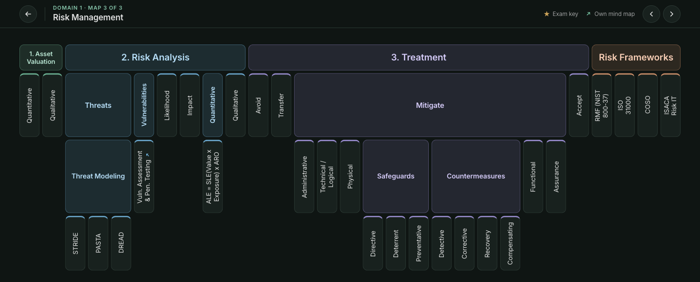
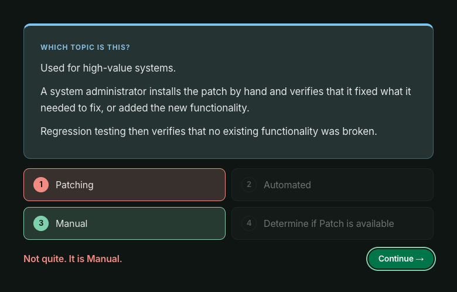
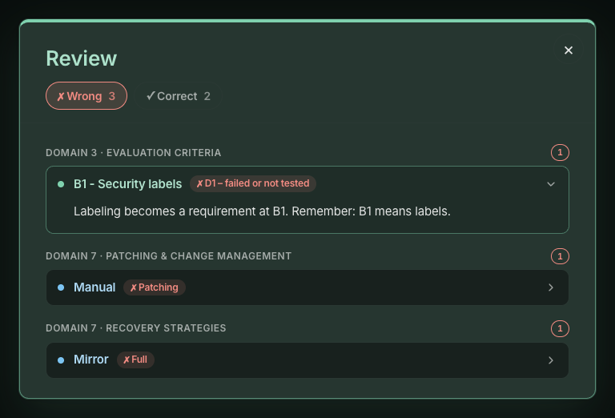

# CISSP Mind Maps

Interactive mind maps of all eight CISSP domains, with a practice quiz to help you remember them.

**Open the site: [cissp.andyq.dev](https://cissp.andyq.dev)**

It is free, has no sign-up, and works on desktop, tablet, and phone.



## What you can do on the site

- **Explore 30 mind maps.** The maps cover all eight domains, with 1,078 topics in total. Each branch has its own colour. Select a topic to read what it means. Hover over a sideways label and the card turns upright so you can read it.
- **Practise every topic.** Select **Practice** on the home page. Each question shows a topic's description with the answer blanked out, and you pick the topic from four options. The wrong options come from the same map, so you choose between topics that are easy to confuse. A run covers all 1,074 questions in a new order each time.
- **Review your answers.** During a run, select the ✓ or ✗ count to list your correct or wrong answers so far. They are grouped by map, with the map that has the most answers at the top.
- **Pick up where you left off.** Your progress and best score stay in your browser on that device, so **Practice** changes to **Resume** when you come back.

<p>
  
  
</p>

## Run the site on your computer

You need Node.js 22.12 or later.

```sh
npm install
npm run dev
```

Then open http://localhost:5173.

To check the types and build the site, run `npm run build`. The build goes to `.cloudflare/output/v0/workers/default/assets/`. The site uses relative paths and hash URLs such as `#/map/risk-management`, so that folder works on any static host.

## Deploy to Cloudflare

The live site is a static-assets Worker on Cloudflare at https://cissp.andyq.dev. `cloudflare.config.ts` holds the Worker name and the custom domain.

Deploying uses the `cf` CLI, which supports Node.js 22.23+, 24.22+, or 26.12+.

1. Sign in once with `npx cf auth login`.
2. Run `npm run deploy`. It checks the types, builds with Vite, and deploys with the `cf` CLI.

The home page footer shows the build date, so you can confirm which version is live.

## Add or change a mind map

Each mind map is one JSON file in `data/`. The site loads every `data/*.json` file, so a new file appears on the home page and in the practice questions without any code change.

A map file has these fields:

| Field | Meaning |
| --- | --- |
| `id`, `title`, `description` | The map's URL slug, name, and one-sentence summary. |
| `domain`, `order` | The CISSP domain number and the map's position within the domain. |
| `source` | A link to the original material. |
| `layout` | Optional. `"stacked"` shows each top-level node as its own full-width section. |
| `nodes` | The top-level nodes. |

Each node has `id`, `title`, `description`, and `children`. A node can also have these optional fields:

- `highlight`: `"own-mindmap"` for a topic with its own mind map, or `"exam-key"` for a key exam topic.
- `mindmap`: the `id` of the map that covers the topic in detail.

Node `id` values must be unique within a file. In a `description`, a line that starts with `- ` shows as a bullet, and a line that starts with `1. ` shows as a numbered item.

## Source and credit

The topics and their structure come from the [Destination Certification CISSP MindMap videos](https://destcert.com/resources/). The descriptions are rewritten in plain English for study.

Built by [Andy Quach](https://andyq.dev) · [GitHub](https://github.com/anthoai97) · [LinkedIn](https://linkedin.com/in/anquachdev)
